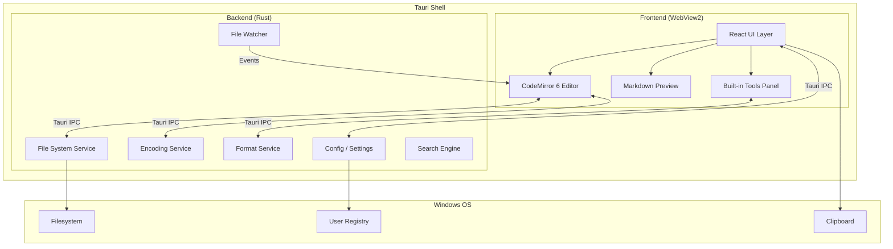

# 🚀 Editron — Product Plan & Implementation Document

> **A next-generation, lightweight text editor for Windows — the spiritual successor to Notepad++, built for the modern developer.**

---

## 1. Executive Summary

**Editron** is a blazing-fast, feature-rich text editor designed to replace Notepad++ for developers who need more than raw text editing but don't want the weight of a full IDE. It combines a compact, elegant UI with powerful built-in utilities — Markdown preview, JSON/XML/YAML formatting, Base64 & JWT encoding/decoding, Unicode & emoji support — all in a lightweight package that installs per-user without requiring admin privileges.

| Property | Target |
|:---|:---|
| **Installer Size** | < 15 MB |
| **Idle RAM** | < 80 MB |
| **Cold Startup** | < 2 seconds |
| **Install Privilege** | User-level only (no UAC) |
| **Platform** | Windows 10/11 (64-bit) |

---

## 2. Technology Stack

### 2.1 Application Framework: **Tauri v2** (Rust + WebView2)

| Criteria | Why Tauri |
|:---|:---|
| **Bundle Size** | ~3–15 MB (vs ~150 MB for Electron) |
| **RAM Footprint** | ~40–80 MB idle (vs ~200 MB for Electron) |
| **Backend** | Rust — blazing-fast file I/O, zero-cost abstractions |
| **Frontend Rendering** | Windows WebView2 (built into Win10/11) |
| **Install Model** | NSIS per-user installer → `%LocalAppData%\Editron` |
| **Auto-Update** | Built-in Tauri updater (no admin needed) |

### 2.2 Frontend

| Layer | Technology | Rationale |
|:---|:---|:---|
| **UI Framework** | React 19 + TypeScript | Component model, ecosystem, type safety |
| **Bundler** | Vite 6 | Sub-second HMR, native ESM, tree-shaking |
| **Code Editor Core** | CodeMirror 6 | Modular (~50–300 KB), mobile-friendly, Lezer parser, multi-instance support |
| **Markdown Rendering** | `markdown-it` + `highlight.js` | Lightweight, extensible, fast |
| **Styling** | Vanilla CSS + CSS Variables | Full control, zero runtime cost, theme system |
| **Icons** | Lucide Icons (tree-shakeable) | Crisp, consistent, tiny footprint |

### 2.3 Backend (Rust / Tauri Commands)

| Responsibility | Approach |
|:---|:---|
| **File I/O** | Rust `tokio::fs` async read/write with streaming for large files |
| **File Watching** | `notify` crate for real-time external change detection |
| **Settings Persistence** | `tauri-plugin-store` → JSON config in `%AppData%\Editron` |
| **Encoding Detection** | `chardetng` crate for auto-detect; `encoding_rs` for transcoding |
| **Search & Replace** | `regex` crate (Rust) for high-performance regex search |
| **Syntax Detection** | File extension mapping + shebang line detection |
| **System Tray** | Tauri system tray API for background operation |

---

## 3. Architecture



### 3.1 Key Architecture Principles

1. **Separation of Concerns** — UI rendering in the webview; heavy computation (regex search, encoding, formatting) in Rust
2. **Async-first** — All file and network operations are non-blocking
3. **Plugin-ready** — Internal module system designed for future plugin extensibility
4. **State Isolation** — Each editor tab owns its own CodeMirror state; no global mutation

---

## 4. Feature Specification

### 4.1 Core Editor Features

| # | Feature | Description | Priority |
|:--|:---|:---|:---|
| E1 | **Multi-tab Editing** | Draggable, closable, reorderable tabs with dirty-state indicators | P0 |
| E2 | **Syntax Highlighting** | 50+ languages via CodeMirror language packs (JS, Python, Rust, C#, Go, SQL, etc.) | P0 |
| E3 | **Line Numbers & Gutters** | Line numbers, fold markers, breakpoint-style markers | P0 |
| E4 | **Code Folding** | Collapse/expand blocks by indent or syntax | P0 |
| E5 | **Find & Replace** | Regex-aware, multi-file search, match highlighting | P0 |
| E6 | **Auto-indent & Bracket Matching** | Smart indent, auto-close brackets/quotes, rainbow brackets | P0 |
| E7 | **Multiple Cursors** | Ctrl+D / Alt+Click multi-cursor editing | P0 |
| E8 | **Minimap** | Scrollable code overview (toggle) | P1 |
| E9 | **Word Wrap Toggle** | Soft-wrap / no-wrap modes | P0 |
| E10 | **Large File Support** | Stream-load files > 100 MB; virtual scrolling | P0 |
| E11 | **Line Sorting** | Sort selected lines ascending/descending | P1 |
| E12 | **Column Selection** | Alt+Shift block/column select mode | P1 |
| E13 | **Undo/Redo History** | Deep undo tree with branching | P0 |
| E14 | **Drag & Drop** | Open files by dragging onto the editor | P0 |
| E15 | **Go to Line / Symbol** | Ctrl+G for line; Ctrl+Shift+O for symbols | P0 |

### 4.2 Markdown Editor & Viewer

| # | Feature | Description | Priority |
|:--|:---|:---|:---|
| M1 | **Live Split Preview** | Side-by-side editor + rendered HTML preview | P0 |
| M2 | **Synchronized Scrolling** | Preview scroll syncs with editor cursor position | P0 |
| M3 | **GFM Support** | Tables, task lists, strikethrough, footnotes | P0 |
| M4 | **Mermaid Diagrams** | Render mermaid code blocks inline in preview | P1 |
| M5 | **Math Rendering** | KaTeX for inline/block math | P1 |
| M6 | **Table of Contents** | Auto-generated TOC from headings in sidebar | P1 |
| M7 | **Export to HTML/PDF** | One-click export with styled output | P1 |
| M8 | **Toolbar** | Compact formatting bar (bold, italic, link, code, list) | P0 |
| M9 | **Image Preview** | Inline preview for local/remote image paths | P1 |

### 4.3 Formatters & Beautifiers

| # | Feature | Description | Priority |
|:--|:---|:---|:---|
| F1 | **JSON Formatter** | Pretty-print, minify, validate, tree-view, sort keys, collapse levels | P0 |
| F2 | **XML Formatter** | Pretty-print, minify, validate, auto-indent | P0 |
| F3 | **YAML Formatter** | Pretty-print, validate, JSON ↔ YAML conversion | P0 |
| F4 | **HTML Formatter** | Pretty-print, minify | P1 |
| F5 | **CSS Formatter** | Pretty-print, minify | P1 |
| F6 | **SQL Formatter** | Pretty-print SQL queries | P2 |
| F7 | **TOML Support** | Syntax + validation | P2 |

### 4.4 Encoders & Decoders

| # | Feature | Description | Priority |
|:--|:---|:---|:---|
| D1 | **Base64 Encode/Decode** | Text ↔ Base64, file-to-Base64 support | P0 |
| D2 | **URL Encode/Decode** | Full URI component encoding | P0 |
| D3 | **JWT Decode** | Parse header, payload, signature; validate expiry; display claims table | P0 |
| D4 | **JWT Encode** | Build JWT from payload + secret (HMAC) | P1 |
| D5 | **HTML Entity Encode/Decode** | `&amp;` ↔ `&`, etc. | P1 |
| D6 | **Hash Generator** | MD5, SHA-1, SHA-256, SHA-512 from text or file | P1 |
| D7 | **Unicode Escape/Unescape** | `\u00E9` ↔ `é` | P1 |
| D8 | **Hex ↔ Text** | Hex viewer and converter | P2 |

### 4.5 Unicode & Rich Text Support

| # | Feature | Description | Priority |
|:--|:---|:---|:---|
| U1 | **Full Unicode Rendering** | Render all Unicode planes including CJK, Arabic, Devanagari | P0 |
| U2 | **Emoji Picker** | Searchable emoji panel (Win+. integration + custom picker) | P0 |
| U3 | **Unicode Character Inspector** | Hover any character to see codepoint, block, name | P1 |
| U4 | **Unicode Search & Insert** | Search by name → insert character | P1 |
| U5 | **Bidirectional Text** | Proper RTL rendering | P2 |
| U6 | **Character Count** | Chars, words, lines, bytes — always visible in status bar | P0 |

### 4.6 Settings & Configuration

| # | Feature | Description | Priority |
|:--|:---|:---|:---|
| S1 | **Default Save Folder** | Configurable default directory for new files | P0 |
| S2 | **Theme Selection** | Dark (default), Light, High Contrast, + 10 accent themes | P0 |
| S3 | **Font Configuration** | Font family, size, line height, ligatures toggle | P0 |
| S4 | **Tab Size & Spaces** | Configurable tab width; tabs vs spaces | P0 |
| S5 | **Auto-save** | Timed auto-save with configurable interval | P0 |
| S6 | **Session Restore** | Reopen last session tabs on launch | P0 |
| S7 | **File Associations** | Register as handler for `.txt`, `.md`, `.json`, etc. (user-level) | P1 |
| S8 | **Backup & Recovery** | Automatic backup of unsaved files to temp directory | P0 |
| S9 | **Encoding Preference** | Default encoding (UTF-8 by default); per-file override | P0 |
| S10 | **Key Bindings** | Customizable keybindings; Notepad++/VS Code/Sublime presets | P1 |
| S11 | **Settings File** | JSON-based settings file at `%AppData%\Editron\settings.json` | P0 |

### 4.7 Additional "Delight" Features

| # | Feature | Description | Priority |
|:--|:---|:---|:---|
| X1 | **Command Palette** | Ctrl+Shift+P — search all actions, settings, tools | P0 |
| X2 | **Diff Viewer** | Side-by-side file comparison with inline diffs | P1 |
| X3 | **Snippet Manager** | User-defined text snippets with tab triggers | P1 |
| X4 | **Regex Tester** | Test regex patterns against sample text with live matching | P1 |
| X5 | **Color Picker** | Inline color preview + picker for hex/rgb/hsl values | P1 |
| X6 | **Timestamp Converter** | Unix timestamp ↔ human-readable datetime | P1 |
| X7 | **Lorem Ipsum Generator** | Insert placeholder text (words, sentences, paragraphs) | P2 |
| X8 | **Text Statistics** | Reading time, Flesch score, frequency analysis | P2 |
| X9 | **Zen Mode** | Distraction-free fullscreen editing | P1 |
| X10 | **Recent Files** | Quick-access list with pinned favorites | P0 |
| X11 | **File Tree Explorer** | Sidebar with folder/file tree for opened workspace | P1 |
| X12 | **Terminal Panel** | Embedded PowerShell/cmd terminal at bottom of window | P2 |
| X13 | **Clipboard History** | Ring-buffer of last 20 clipboard entries | P2 |

---

## 5. UI / UX Design

### 5.1 Design Philosophy

> *"Chrome-less editing. Tools when you need them. Out of the way when you don't."*

- **Compact Menu Bar** — Single-row menu bar with small 12px font; menus: `File` `Edit` `View` `Tools` `Format` `Help`
- **Icon-only Toolbar** — Optional slim toolbar (20px height) with most-used actions
- **Tabbed Documents** — Compact 28px tabs; scrollable overflow with "show all tabs" dropdown
- **Status Bar** — 22px bottom bar: encoding, line ending, language, cursor position, char/word/line count
- **Side Panels** — Collapsible left (file tree) and right (tools) panels
- **Command Palette** — The primary discovery mechanism for all features

### 5.2 Layout

```
┌──────────────────────────────────────────────────────────┐
│  ☰ File  Edit  View  Tools  Format  Help          ─ □ ✕ │ ← Menu Bar (24px)
├──────────────────────────────────────────────────────────┤
│ 📄 main.js │ 📝 README.md │ ⚙ settings.json │     ⌄  + │ ← Tab Bar (28px)
├─────┬────────────────────────────────────────┬───────────┤
│     │                                        │           │
│  📁 │  1 │ import React from 'react';        │  🔧 Tools │ ← Panels
│ src │  2 │ import { render } from 'react-dom';│  ┌──────┐ │
│ ├ a │  3 │                                    │  │Base64│ │
│ ├ b │  4 │ function App() {                   │  │ JWT  │ │
│ └ c │  5 │   return <h1>Hello</h1>;           │  │Format│ │
│     │  6 │ }                                  │  │Regex │ │
│     │                                        │  └──────┘ │
├─────┴────────────────────────────────────────┴───────────┤
│ UTF-8 │ LF │ JavaScript │ Ln 4, Col 12 │ 6 lines │ 142B │ ← Status Bar (22px)
└──────────────────────────────────────────────────────────┘
```

### 5.3 Theme System

```
┌─────────────────────────────────────────────┐
│  CSS Variable Token System                  │
├─────────────────────────────────────────────┤
│  --bg-primary      → Main background        │
│  --bg-secondary    → Panel backgrounds       │
│  --bg-tertiary     → Input/hover states      │
│  --text-primary    → Main text color         │
│  --text-secondary  → Muted text             │
│  --accent          → Brand color / links     │
│  --accent-hover    → Accent interactions     │
│  --border          → Dividers               │
│  --success         → Green indicators        │
│  --warning         → Yellow indicators       │
│  --error           → Red indicators          │
│  --tab-active-bg   → Active tab background   │
│  --gutter-bg       → Line number gutter      │
└─────────────────────────────────────────────┘
```

**Default Theme: "Obsidian Dark"**
- Background: `#1a1b26` (deep indigo-charcoal)
- Text: `#c0caf5` (cool lavender-white)
- Accent: `#7aa2f7` (soft electric blue)
- Gutter: `#24283b`
- Selection: `#364a82`

---

## 6. Menu Structure

```
File                  Edit                  View
├─ New File      ⌃N   ├─ Undo         ⌃Z   ├─ Theme          →
├─ New Window    ⌃⇧N  ├─ Redo         ⌃Y   │  ├─ Obsidian Dark
├─ Open File     ⌃O   ├─ ──────────        │  ├─ Frost Light
├─ Open Folder   ⌃K⌃O ├─ Cut          ⌃X   │  ├─ High Contrast
├─ ──────────         ├─ Copy         ⌃C   │  └─ More...
├─ Save          ⌃S   ├─ Paste        ⌃V   ├─ ──────────
├─ Save As       ⌃⇧S  ├─ Select All   ⌃A   ├─ Word Wrap        ⌃⇧W
├─ Save All      ⌃K S ├─ ──────────        ├─ Minimap          ⌃⇧M
├─ ──────────         ├─ Find         ⌃F   ├─ Line Numbers
├─ Recent Files  →    ├─ Replace      ⌃H   ├─ ──────────
├─ ──────────         ├─ Find in Files ⌃⇧F  ├─ File Explorer    ⌃B
├─ Preferences   ⌃,   ├─ ──────────        ├─ Tools Panel      ⌃⇧T
├─ ──────────         ├─ Multi-Cursor →    ├─ ──────────
└─ Exit          ⌃Q   ├─ Sort Lines   →    ├─ Zen Mode         ⌃K Z
                      └─ Transform    →    ├─ Zoom In          ⌃+
                         ├─ UPPERCASE       ├─ Zoom Out         ⌃-
                         ├─ lowercase       └─ Reset Zoom       ⌃0
                         ├─ Title Case
                         ├─ camelCase      Tools
                         └─ snake_case     ├─ Markdown Preview  ⌃⇧V
                                          ├─ ──────────
Format                                    ├─ Base64 Encode/Decode
├─ Format Document    ⌃⇧F                ├─ URL Encode/Decode
├─ ──────────                             ├─ JWT Decode
├─ JSON Pretty Print                      ├─ ──────────
├─ JSON Minify                            ├─ Hash Generator
├─ JSON ↔ YAML                            ├─ Regex Tester
├─ ──────────                             ├─ Color Picker
├─ XML Pretty Print                       ├─ Timestamp Converter
├─ XML Minify                             ├─ Unicode Inspector
├─ ──────────                             ├─ ──────────
├─ YAML Format                            ├─ Diff Viewer
├─ ──────────                             ├─ Snippet Manager
├─ Trim Whitespace                        └─ Clipboard History
├─ Remove Empty Lines
└─ Encoding       →
   ├─ UTF-8
   ├─ UTF-8 with BOM
   ├─ UTF-16 LE
   ├─ UTF-16 BE
   ├─ Windows-1252
   └─ ISO-8859-1
```

---

## 7. Directory Structure

```
editron/
├── src-tauri/                     # Rust backend
│   ├── Cargo.toml
│   ├── tauri.conf.json            # Tauri configuration
│   ├── build.rs
│   ├── icons/                     # App icons (all sizes)
│   └── src/
│       ├── main.rs                # Entry point
│       ├── lib.rs                 # Module exports
│       ├── commands/              # Tauri IPC command handlers
│       │   ├── mod.rs
│       │   ├── file_ops.rs        # Open, save, read, write
│       │   ├── encoding.rs        # Detect/transcode encodings
│       │   ├── format.rs          # JSON/XML/YAML formatting
│       │   ├── crypto.rs          # Base64, JWT, hashing
│       │   ├── search.rs          # Regex search/replace
│       │   └── settings.rs        # Read/write config
│       ├── services/
│       │   ├── mod.rs
│       │   ├── file_watcher.rs    # notify-based watcher
│       │   ├── recent_files.rs    # Recent files manager
│       │   ├── backup.rs          # Auto-backup service
│       │   └── updater.rs         # Auto-update handler
│       └── models/
│           ├── mod.rs
│           ├── config.rs          # Settings schema
│           └── file_meta.rs       # File metadata types
│
├── src/                           # React frontend
│   ├── main.tsx                   # App entry
│   ├── App.tsx                    # Root component
│   ├── index.css                  # Global styles + CSS variables
│   ├── themes/
│   │   ├── obsidian-dark.css
│   │   ├── frost-light.css
│   │   └── high-contrast.css
│   ├── components/
│   │   ├── layout/
│   │   │   ├── MenuBar.tsx
│   │   │   ├── TabBar.tsx
│   │   │   ├── StatusBar.tsx
│   │   │   ├── SidePanel.tsx
│   │   │   └── CommandPalette.tsx
│   │   ├── editor/
│   │   │   ├── EditorPane.tsx     # CodeMirror wrapper
│   │   │   ├── EditorTabs.tsx
│   │   │   ├── Minimap.tsx
│   │   │   └── GutterExtensions.tsx
│   │   ├── markdown/
│   │   │   ├── MarkdownPreview.tsx
│   │   │   ├── MarkdownToolbar.tsx
│   │   │   └── MermaidRenderer.tsx
│   │   ├── tools/
│   │   │   ├── ToolsPanel.tsx
│   │   │   ├── Base64Tool.tsx
│   │   │   ├── JwtTool.tsx
│   │   │   ├── HashTool.tsx
│   │   │   ├── RegexTester.tsx
│   │   │   ├── ColorPicker.tsx
│   │   │   ├── TimestampConverter.tsx
│   │   │   ├── UnicodeInspector.tsx
│   │   │   └── EmojiPicker.tsx
│   │   ├── formatters/
│   │   │   ├── JsonFormatter.tsx
│   │   │   ├── XmlFormatter.tsx
│   │   │   ├── YamlFormatter.tsx
│   │   │   └── JsonTreeView.tsx
│   │   ├── settings/
│   │   │   ├── SettingsDialog.tsx
│   │   │   └── KeybindingsEditor.tsx
│   │   ├── search/
│   │   │   ├── FindReplace.tsx
│   │   │   └── FindInFiles.tsx
│   │   └── common/
│   │       ├── Dialog.tsx
│   │       ├── Tooltip.tsx
│   │       ├── ContextMenu.tsx
│   │       └── Dropdown.tsx
│   ├── hooks/
│   │   ├── useEditor.ts
│   │   ├── useFileOps.ts
│   │   ├── useSettings.ts
│   │   ├── useTheme.ts
│   │   ├── useKeybindings.ts
│   │   └── useCommandPalette.ts
│   ├── store/
│   │   ├── editorStore.ts         # Zustand store for editor state
│   │   ├── settingsStore.ts
│   │   └── uiStore.ts
│   ├── services/
│   │   ├── tauriBridge.ts         # Tauri invoke wrappers
│   │   ├── formatterService.ts
│   │   ├── encoderService.ts
│   │   └── fileService.ts
│   └── utils/
│       ├── languageDetect.ts
│       ├── shortcuts.ts
│       └── constants.ts
│
├── public/
│   └── favicon.ico
├── package.json
├── tsconfig.json
├── vite.config.ts
└── README.md
```

---

## 8. Installation & Packaging

### 8.1 Per-User Install (No Admin Required)

```json
// src-tauri/tauri.conf.json (relevant excerpt)
{
  "bundle": {
    "active": true,
    "targets": ["nsis"],
    "windows": {
      "nsis": {
        "installMode": "currentUser",
        "installerIcon": "icons/icon.ico",
        "displayLanguageSelector": false,
        "headerImage": "icons/header.bmp"
      }
    },
    "icon": [
      "icons/32x32.png",
      "icons/128x128.png",
      "icons/icon.ico"
    ]
  }
}
```

**Install Path:** `%LocalAppData%\Editron\`
**Settings Path:** `%AppData%\Editron\settings.json`
**Backup Path:** `%AppData%\Editron\backups\`
**Default Save Folder:** `%UserProfile%\Documents\Editron\` (configurable)

### 8.2 Portable Mode

Also ship a `.zip` portable build — just extract and run `Editron.exe`. Settings stored alongside the executable in `./config/`.

### 8.3 File Associations (User-Level)

Register via `HKEY_CURRENT_USER\Software\Classes` — no admin required:

```
.txt, .md, .json, .xml, .yaml, .yml, .toml, .csv, .log,
.js, .ts, .py, .rs, .go, .java, .c, .cpp, .h, .css,
.html, .htm, .sql, .sh, .bat, .ps1, .ini, .cfg, .env
```

---

## 9. Settings Schema

```jsonc
// %AppData%\Editron\settings.json
{
  "editor": {
    "fontFamily": "JetBrains Mono, Cascadia Code, Consolas, monospace",
    "fontSize": 14,
    "lineHeight": 1.6,
    "tabSize": 4,
    "insertSpaces": true,
    "wordWrap": "off",
    "minimap": false,
    "lineNumbers": true,
    "bracketMatching": true,
    "autoCloseBrackets": true,
    "highlightActiveLine": true,
    "renderWhitespace": "selection",
    "fontLigatures": true,
    "cursorBlinking": "smooth",
    "cursorStyle": "line",
    "scrollBeyondLastLine": false
  },
  "files": {
    "defaultSaveFolder": "%UserProfile%\\Documents\\Editron",
    "defaultEncoding": "utf-8",
    "defaultLineEnding": "lf",
    "autoSave": true,
    "autoSaveInterval": 30000,
    "trimTrailingWhitespace": false,
    "insertFinalNewline": true,
    "watchExternalChanges": true,
    "maxRecentFiles": 25
  },
  "appearance": {
    "theme": "obsidian-dark",
    "accentColor": "#7aa2f7",
    "menuBarVisible": true,
    "statusBarVisible": true,
    "compactMode": false,
    "uiScale": 1.0
  },
  "markdown": {
    "previewTheme": "github-dark",
    "mathEnabled": true,
    "mermaidEnabled": true,
    "syncScroll": true
  },
  "keybindings": "default",
  "backup": {
    "enabled": true,
    "interval": 60000,
    "maxBackups": 10,
    "backupFolder": "%AppData%\\Editron\\backups"
  },
  "tools": {
    "defaultBase64Mode": "encode",
    "jwtDefaultAlgorithm": "HS256",
    "hashDefaultAlgorithm": "SHA-256",
    "jsonIndentSize": 2,
    "xmlIndentSize": 2
  }
}
```

---

## 10. Keyboard Shortcuts

| Category | Action | Shortcut |
|:---|:---|:---|
| **File** | New File | `Ctrl+N` |
| | Open File | `Ctrl+O` |
| | Save | `Ctrl+S` |
| | Save As | `Ctrl+Shift+S` |
| | Close Tab | `Ctrl+W` |
| | Preferences | `Ctrl+,` |
| **Edit** | Undo | `Ctrl+Z` |
| | Redo | `Ctrl+Y` |
| | Find | `Ctrl+F` |
| | Replace | `Ctrl+H` |
| | Find in Files | `Ctrl+Shift+F` |
| | Duplicate Line | `Ctrl+Shift+D` |
| | Move Line Up | `Alt+↑` |
| | Move Line Down | `Alt+↓` |
| | Toggle Comment | `Ctrl+/` |
| | Multi-cursor | `Ctrl+D` / `Alt+Click` |
| **View** | Command Palette | `Ctrl+Shift+P` |
| | Toggle Sidebar | `Ctrl+B` |
| | Toggle Tools Panel | `Ctrl+Shift+T` |
| | Zen Mode | `Ctrl+K Z` |
| | Markdown Preview | `Ctrl+Shift+V` |
| | Toggle Word Wrap | `Alt+Z` |
| **Navigate** | Go to Line | `Ctrl+G` |
| | Go to File | `Ctrl+P` |
| | Next Tab | `Ctrl+Tab` |
| | Previous Tab | `Ctrl+Shift+Tab` |
| **Format** | Format Document | `Shift+Alt+F` |

---

## 11. Implementation Phases

### Phase 1 — Foundation (Weeks 1–3) 🏗️

> **Goal:** Bootable app with basic text editing

| Task | Details | Deliverable |
|:---|:---|:---|
| Project scaffold | Tauri v2 + React + Vite + TypeScript | Buildable project |
| CodeMirror integration | Basic editor with syntax highlighting | Editor component |
| Tab system | Open, close, switch, reorder tabs | Tab bar |
| File I/O | Open, save, save-as via Rust backend | File operations |
| Menu bar | Compact File/Edit/View menus | Menu component |
| Status bar | Encoding, line ending, cursor position | Status bar |
| Theme system | CSS variables + dark theme | Theme engine |
| Settings infrastructure | Read/write settings.json | Settings service |

### Phase 2 — Power Editing (Weeks 4–5) ⚡

> **Goal:** Feature parity with Notepad++ core

| Task | Details | Deliverable |
|:---|:---|:---|
| Find & Replace | Regex support, highlight matches | Search UI |
| Multi-cursor | Ctrl+D, Alt+Click | Editor extension |
| Code folding | Syntax-aware folding | CM extension |
| Auto-indent | Smart indent, bracket auto-close | CM extension |
| Line operations | Sort, duplicate, move, delete | Editor commands |
| Word wrap toggle | Soft wrap mode | View option |
| Large file handling | Streaming reads in Rust | Backend service |
| Encoding detection | Auto-detect + manual override | Encoding service |
| Session restore | Reopen tabs on launch | Persistence |
| Recent files | Track + display recent files | File service |

### Phase 3 — Tools & Formatters (Weeks 6–7) 🔧

> **Goal:** All built-in tools operational

| Task | Details | Deliverable |
|:---|:---|:---|
| JSON formatter | Pretty-print, minify, validate, tree view | Tool component |
| XML formatter | Pretty-print, minify, validate | Tool component |
| YAML formatter | Format, validate, JSON↔YAML | Tool component |
| Base64 encoder/decoder | Text and file support | Tool component |
| JWT decoder/encoder | Parse, display, validate | Tool component |
| URL encoder/decoder | Full URI encoding | Tool component |
| Hash generator | MD5, SHA-1/256/512 | Tool component |
| Tools panel | Collapsible right sidebar | Panel layout |
| Command palette | Ctrl+Shift+P → all actions | Modal component |

### Phase 4 — Markdown & Rich Text (Weeks 8–9) 📝

> **Goal:** Full markdown editing experience

| Task | Details | Deliverable |
|:---|:---|:---|
| Markdown preview | Split pane with rendered HTML | Preview component |
| Sync scrolling | Editor ↔ preview scroll sync | Scroll service |
| GFM support | Tables, task lists, footnotes | MD extensions |
| Markdown toolbar | Formatting buttons | Toolbar component |
| Emoji picker | Searchable emoji insertion | Picker component |
| Unicode inspector | Character details on hover | Inspector component |
| Mermaid rendering | Diagram blocks in preview | Renderer component |
| Export HTML/PDF | Styled export | Export service |

### Phase 5 — Polish & Ship (Weeks 10–12) 🚢

> **Goal:** Production-ready v1.0

| Task | Details | Deliverable |
|:---|:---|:---|
| Diff viewer | Side-by-side file comparison | Diff component |
| Regex tester | Live pattern matching | Tool component |
| Color picker | Inline color preview + picker | Tool component |
| Timestamp converter | Unix ↔ datetime | Tool component |
| File tree explorer | Sidebar folder browser | Tree component |
| Snippet manager | Create/insert snippets | Snippet system |
| Keybinding customization | Remap shortcuts | Settings UI |
| Auto-updater | Tauri updater integration | Update service |
| NSIS installer | Per-user, no-admin install | Installer |
| Portable build | Zip distribution | Portable package |
| Performance optimization | Startup time, memory profiling | Optimization |
| Documentation | User guide, keyboard shortcuts | Docs |

---

## 12. Performance Targets

| Metric | Target | Strategy |
|:---|:---|:---|
| **Cold startup** | < 2s | Pre-built WebView2; lazy-load CM language packs |
| **File open (1 MB)** | < 200ms | Rust async file read; stream to editor |
| **File open (100 MB)** | < 3s | Virtual scrolling; partial load; Rust streaming |
| **Search (1 MB file)** | < 50ms | Rust regex crate (DFA-optimized) |
| **JSON format (1 MB)** | < 100ms | Rust serde_json; send formatted result to frontend |
| **Idle RAM** | < 80 MB | No bundled Chromium; CodeMirror lazy extensions |
| **Installer size** | < 15 MB | Tauri + tree-shaken frontend; no Chromium |

---

## 13. Build & Dev Commands

```bash
# Prerequisites
# - Rust (via rustup)
# - Node.js 20+
# - WebView2 (built into Windows 10/11)

# Initial setup
npm create tauri-app@latest editron -- --template react-ts
cd editron
npm install

# Development
npm run tauri dev          # Hot-reload dev mode

# Production build
npm run tauri build        # Produces NSIS installer + portable exe

# Run tests
cargo test --manifest-path src-tauri/Cargo.toml   # Rust tests
npm test                                            # Frontend tests
```

---

## 14. Key Dependencies

### Frontend (npm)

| Package | Purpose |
|:---|:---|
| `@codemirror/state` | Editor state management |
| `@codemirror/view` | Editor view layer |
| `@codemirror/language` | Language support infrastructure |
| `@codemirror/lang-*` | Language packs (javascript, python, html, css, json, xml, markdown, etc.) |
| `@codemirror/search` | Find/replace extension |
| `@codemirror/autocomplete` | Autocompletion |
| `@codemirror/lint` | Linting infrastructure |
| `@tauri-apps/api` | Tauri frontend bindings |
| `@tauri-apps/plugin-*` | Tauri plugins (store, dialog, fs, shell) |
| `markdown-it` | Markdown parsing |
| `highlight.js` | Syntax highlighting in preview |
| `mermaid` | Diagram rendering |
| `katex` | Math rendering |
| `zustand` | Lightweight state management |
| `lucide-react` | Icons |
| `react-resizable-panels` | Splitter panels |
| `jose` | JWT handling |
| `js-yaml` | YAML parsing |

### Backend (Cargo)

| Crate | Purpose |
|:---|:---|
| `tauri` | Application framework |
| `serde` / `serde_json` | Serialization |
| `tokio` | Async runtime |
| `notify` | File system watcher |
| `regex` | Regular expressions |
| `encoding_rs` | Character encoding |
| `chardetng` | Encoding auto-detection |
| `base64` | Base64 encode/decode |
| `sha2` / `md-5` | Hash generation |
| `jsonwebtoken` | JWT handling |
| `quick-xml` | XML parsing/formatting |
| `serde_yaml` | YAML parsing/formatting |
| `tauri-plugin-store` | Persistent config store |
| `tauri-plugin-dialog` | Native file dialogs |

---

## 15. Risk Mitigation

| Risk | Impact | Mitigation |
|:---|:---|:---|
| WebView2 not present on older Windows | App won't launch | Bundle WebView2 bootstrapper; detect and prompt install |
| Large file performance | UI freeze | Rust-side streaming; virtual scrolling; web worker for CM |
| CodeMirror memory on many tabs | High RAM | Dispose inactive tab editor states; reconstruct on focus |
| NSIS user-install blocked by GPO | Can't install | Provide portable `.zip` alternative |
| Theme/font rendering inconsistency | Visual glitches | Comprehensive cross-version Windows testing |

---

## 16. Future Roadmap (Post v1.0)

| Version | Features |
|:---|:---|
| **v1.1** | Plugin system (JS/TS plugins), Git integration status bar |
| **v1.2** | AI-assisted editing (local LLM via Ollama), split editor |
| **v1.3** | Collaborative editing (CRDT-based), cloud sync settings |
| **v2.0** | macOS + Linux support, full plugin marketplace |

---

> [!IMPORTANT]
> **Next Step:** Approve this plan, and I'll begin scaffolding the Tauri + React project and implementing Phase 1 (Foundation).
